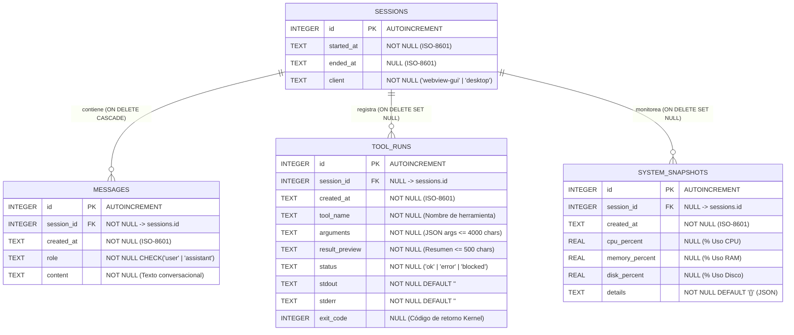
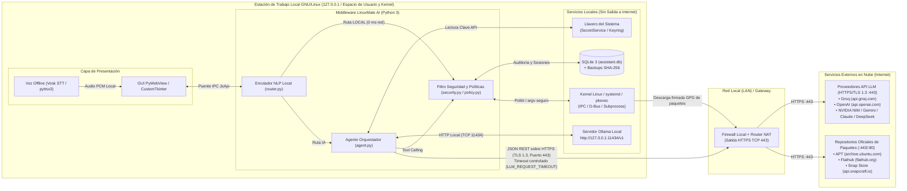

# Diagramas de Base de Datos (E-R / Relacional) y de Red del Proyecto LinuxMate AI

Este documento contiene tanto el **Diagrama Entidad-Relación / Relacional de Datos (ERD)** como el **Diagrama de Red y Topología de Despliegue** del proyecto **LinuxMate AI (Asistente Linux)**, listos para integrarse en el **Capítulo IV (Análisis y Diseño de la Aplicación)** del trabajo de graduación.

---

## 1. Diagrama Entidad-Relación / Relacional de Datos (Base de Datos SQLite `assistant.db`)

El esquema relacional está implementado en [`src/core/storage.py`](../src/core/storage.py) sobre **SQLite 3** (`~/.config/asistente-linux/assistant.db`) con integridad referencial activa (`PRAGMA foreign_keys = ON`).

### 1.1 Diagrama E-R (Mermaid)

### 1.2 Diccionario de Datos de `assistant.db`

| Tabla | Campo | Tipo de Dato | Restricciones / Claves | Descripción Técnica |
| :--- | :--- | :--- | :--- | :--- |
| **`sessions`** | `id` | `INTEGER` | `PRIMARY KEY AUTOINCREMENT` | Identificador único de la sesión de uso del asistente. |
| | `started_at` | `TEXT` | `NOT NULL` | Fecha y hora de inicio en formato ISO-8601. |
| | `ended_at` | `TEXT` | `NULL` | Fecha y hora de cierre de la sesión. |
| | `client` | `TEXT` | `NOT NULL` | Interfaz que inició la sesión (`webview-gui` o `desktop`). |
| **`messages`** | `id` | `INTEGER` | `PRIMARY KEY AUTOINCREMENT` | Identificador único del mensaje en el historial. |
| | `session_id` | `INTEGER` | `NOT NULL`, `FK -> sessions(id)` | Sesión a la que pertenece (`ON DELETE CASCADE`, índice `idx_messages_session`). |
| | `created_at` | `TEXT` | `NOT NULL` | Marca temporal exacta del mensaje. |
| | `role` | `TEXT` | `NOT NULL CHECK(role IN ('user','assistant'))` | Autor del mensaje (usuario o respuesta del asistente). |
| | `content` | `TEXT` | `NOT NULL` | Contenido textual de la consulta o explicación pedagógica. |
| **`tool_runs`** | `id` | `INTEGER` | `PRIMARY KEY AUTOINCREMENT` | Identificador único de auditoría de ejecución. |
| | `session_id` | `INTEGER` | `NULL`, `FK -> sessions(id)` | Sesión asociada (`ON DELETE SET NULL`). |
| | `created_at` | `TEXT` | `NOT NULL` | Marca temporal de ejecución (índice `idx_tool_runs_created`). |
| | `tool_name` | `TEXT` | `NOT NULL` | Herramienta invocada del catálogo `LINUX_TOOLS`. |
| | `arguments` | `TEXT` | `NOT NULL` | Argumentos en formato JSON enviados a la herramienta. |
| | `result_preview` | `TEXT` | `NOT NULL` | Vista previa truncada a 500 caracteres del resultado. |
| | `status` | `TEXT` | `NOT NULL` | Resultado de seguridad/ejecución: `ok`, `error` o `blocked`. |
| | `stdout` | `TEXT` | `NOT NULL DEFAULT ''` | Salida estándar completa devuelta por el subproceso Linux. |
| | `stderr` | `TEXT` | `NOT NULL DEFAULT ''` | Salida de error estándar capturada. |
| | `exit_code` | `INTEGER` | `NULL` | Código de salida del proceso en el sistema operativo (`0` = éxito). |
| **`system_snapshots`** | `id` | `INTEGER` | `PRIMARY KEY AUTOINCREMENT` | Identificador único de la captura de telemetría. |
| | `session_id` | `INTEGER` | `NULL`, `FK -> sessions(id)` | Sesión activa durante la captura (`ON DELETE SET NULL`). |
| | `created_at` | `TEXT` | `NOT NULL` | Marca temporal de la medición de hardware. |
| | `cpu_percent` | `REAL` | `NULL` | Porcentaje instantáneo de uso de procesador. |
| | `memory_percent` | `REAL` | `NULL` | Porcentaje instantáneo de consumo de memoria RAM. |
| | `disk_percent` | `REAL` | `NULL` | Porcentaje de ocupación de la partición raíz (`/`). |
| | `details` | `TEXT` | `NOT NULL DEFAULT '{}'` | Metadatos adicionales serializados en JSON. |

---

## 2. Diagrama de Red y Topología de Comunicaciones del Proyecto

El siguiente diagrama modela la arquitectura de red y comunicaciones de **LinuxMate AI**, diferenciando el tráfico interno de bucle local (`127.0.0.1` / IPC / D-Bus) de las conexiones salientes cifradas hacia Internet (`HTTPS / TLS 1.3` en puerto `443`).

### 2.1 Diagrama de Topología de Red (Mermaid)

### 2.2 Especificación de Protocolos, Puertos y Canales de Comunicación

| Origen | Destino | Protocolo / Mecanismo | Puerto / Ruta | Seguridad Aplicada |
| :--- | :--- | :--- | :--- | :--- |
| **Interfaz Gráfica (`PyWebView`)** | **Backend Python (`JsApi`)** | Puente IPC en memoria (`window.pywebview.api`) | Interno (Proceso local) | Aislamiento en espacio de usuario sin abrir puertos de red expuestos. |
| **Agente Orquestador (`agent.py`)** | **Motor Local Ollama** | `HTTP REST` (Loopback) | `TCP 11434` (`127.0.0.1/v1`) | Tráfico confinado estrictamente a la interfaz `lo` (`localhost`). |
| **Agente Orquestador (`agent.py`)** | **Proveedores Cloud LLM (Groq, OpenAI, etc.)** | `HTTPS REST` (JSON / TLS 1.3) | `TCP 443` (Saliente) | Validación estricta de URL (`urlsplit` en `providers.py`), clave desde `keyring` y *timeout* contra bloqueos. |
| **Motor de Ejecución (`tools.py`)** | **Base de Datos `SQLite`** | Llamadas de sistema POSIX (`sqlite3`) | `~/.config/asistente-linux/assistant.db` | Transacciones ACID e integridad referencial (`FOREIGN KEYS = ON`). |
| **Motor de Privilegios (`privilege.py`)** | **PolicyKit (`polkitd`)** | `D-Bus` / `pkexec` | Bus de sistema local | Autenticación gráfica nativa del sistema y lista blanca de binarios (`com.linuxmate.policy`). |
| **Gestores de Paquetes (`apt`, `flatpak`, `snap`)** | **Repositorios Oficiales** | `HTTPS` / `HTTP` con firma GPG | `TCP 443` / `TCP 80` (Saliente) | Verificación criptográfica de firmas de paquetes de la distribución. |
